# Relatório do Projeto DesapegaUai

**Marketplace C2C hiperlocal — Viçosa e região**

| | |
| --- | --- |
| **Instituição** | Centro Universitário de Viçosa – UNIVIÇOSA |
| **Curso** | Análise e Desenvolvimento de Sistemas |
| **Disciplina** | Engenharia de Software I e Projeto Integrador |
| **Grupo** | ByteForce |
| **Professores** | Carlos Henrique Brumatti e Mirella Lopes |
| **Tema** | Cidades Inteligentes |
| **Local e data** | Viçosa – MG, novembro de 2026 |
| **Repositório** | <https://github.com/DesapegaUai/DesapegaUai> |

## Identificação do projeto

- **Nome:** DesapegaUai
- **Grupo:** ByteForce
- **Instituição:** Centro Universitário de Viçosa – UNIVIÇOSA
- **Curso:** Análise e Desenvolvimento de Sistemas
- **Disciplina:** Engenharia de Software I e Projeto Integrador
- **Professores:** Carlos Henrique Brumatti e Mirella Lopes
- **Período de referência:** 2º semestre de 2026

## Integrantes do grupo

| Integrante | Função |
| --- | --- |
| Alice Risso Campos Faria | Desenvolvedora |
| Anthony Araújo Rocha | Desenvolvedor |
| Henrique Lucrécio Brandão | Desenvolvedor |
| João Pedro Fonseca Elias | Desenvolvedor |
| Marina Vieira de Abreu | Desenvolvedora |
| Rayanne Fernandes Fideles | Scrum Master / líder do grupo |
| Rhayane de Freitas Eloi | Product Owner / Dona do Produto |

## 1. Introdução

O presente relatório reúne as informações e atividades documentadas pelo grupo ByteForce no desenvolvimento do projeto DesapegaUai, elaborado no contexto da disciplina Engenharia de Software I e Projeto Integrador, do curso de Análise e Desenvolvimento de Sistemas da UNIVIÇOSA.

O problema que motivou a proposta está relacionado à dificuldade de comprar e vender produtos usados de maneira organizada, centralizada e eficiente. Em canais dispersos, como grupos de mensagens e redes sociais, os anúncios podem se perder, apresentar informações incompletas ou alcançar pessoas de localidades distantes.

O objetivo geral do sistema é facilitar a compra e a venda de produtos usados entre pessoas de uma mesma localidade, aproximando compradores e vendedores por meio de uma plataforma de classificados com foco hiperlocal em Viçosa e região.

Como solução, o DesapegaUai é uma plataforma web de classificados locais — um marketplace C2C hiperlocal — em que as pessoas publicam anúncios, pesquisam produtos por palavra-chave e filtros, veem primeiro o que está mais perto e conversam com o vendedor. A negociação, o pagamento e a entrega são combinados diretamente entre as partes.

## 2. Descrição do projeto

### 2.1 Público-alvo

Pessoas de Viçosa e da Zona da Mata mineira interessadas em comprar ou vender produtos usados, com destaque para os estudantes universitários: os que chegam à cidade e procuram itens por preços acessíveis e os que estão deixando a cidade e desejam vender seus objetos. Duas personas orientaram o projeto:

- **Larissa Andrade (compradora):** 19 anos, no 1º período, recém-chegada a Viçosa, mora em uma república no bairro Ramos e quer montar o quarto gastando cerca de R$ 500, em vez de R$ 2.000 em produtos novos.
- **Diego Martins (vendedor):** 23 anos, no 9º período, vai sair da cidade em 3 semanas e precisa esvaziar o apartamento rápido.

### 2.2 Objetivos

**Objetivo geral:** desenvolver uma plataforma web responsiva de compra e venda de produtos usados entre moradores de Viçosa e região, que estimule o reaproveitamento de bens e a economia circular.

**Objetivos específicos:**

- Organizar a publicação de anúncios.
- Facilitar a localização de produtos por categoria e por localização, priorizando os anúncios próximos ao usuário.
- Permitir que qualquer pessoa pesquise e visualize os detalhes dos anúncios sem precisar de cadastro.
- Permitir o acesso com a conta Google para publicar anúncios, favoritar produtos e conversar com o vendedor.
- Aproximar comprador e vendedor para contato direto.
- Dar segurança à negociação: avaliação do vendedor, selo de vínculo acadêmico, pontos de encontro seguros, denúncia de usuário e proteção dos dados pessoais.
- Avisar quem procura um produto assim que alguém anunciar algo parecido na mesma cidade (Procura-se).
- Oferecer à região um canal de classificados independente das redes sociais.

### 2.3 Justificativa

Em Viçosa, a compra e venda de usados acontece principalmente em grupos de redes sociais, onde os anúncios se perdem rapidamente e a busca é limitada. Ao mesmo tempo, a cidade recebe e se despede de estudantes a cada semestre: quem chega precisa montar a casa com pouco dinheiro, e quem vai embora precisa se desfazer dos móveis e objetos em pouco tempo.

O DesapegaUai organiza essa troca em um só lugar e, alinhado ao tema Cidades Inteligentes, usa a tecnologia para fortalecer a economia local e reduzir o desperdício:

> alguém desapega → outra pessoa encontra → compra localmente → o produto continua em uso → menos desperdício.

### 2.4 Funcionalidades da versão entregue

| Módulo | Funcionalidades |
| --- | --- |
| Acesso público | Login com Google; busca por palavra-chave e filtros; 8 categorias; página do anúncio; perfil público do vendedor; páginas de ajuda (como funciona, dicas de segurança, Termos de Uso e Política de Privacidade) |
| Localização | Anúncios por proximidade, a partir do GPS (com permissão) ou da cidade e do bairro escolhidos; distância de 1 a 50 km ou personalizada; mapa de anúncios |
| Anúncios | Publicar com até 8 fotos; salvar rascunho; editar; marcar como reservado ou vendido; excluir; meus anúncios; tag de transporte ("Como levar?": cabe na mochila, em carro de aplicativo ou precisa de carreto) |
| Procura-se | O comprador publica o que procura, o bairro e até quanto paga; quando alguém anuncia algo compatível na mesma cidade, os dois são avisados |
| Favoritos | Favoritar, visualizar favoritos e remover dos favoritos |
| Negociação / Chat | Conversa em tempo real com o vendedor (lida, digitando e online); envio de fotos; sugestão de ponto de encontro seguro; oferta rápida com o valor calculado; arquivar e excluir conversa; reservar ou marcar o anúncio como vendido pela conversa |
| Avaliação e segurança | Avaliação do vendedor por quem comprou (1 a 5 estrelas, pontos fortes e comentário); reputação no perfil; selo de vínculo acadêmico para quem entra com o e-mail da UFV ou da Univiçosa; compromisso nas entregas (depois da venda, cada lado diz se o outro compareceu); denúncia de usuário pelo chat |
| Notificações | Avisos de anúncios novos, por distância ou só de uma cidade e bairro; aviso de pedido do Procura-se atendido; aviso de mensagem nova; contador de mensagens não lidas |
| Perfil | Visualizar e editar o perfil; foto de perfil; excluir a conta, com os anúncios, as conversas e as fotos |
| Sessão | Fazer logout |

**Fora do escopo desta versão:** cadastro com e-mail e senha, login com Apple, processamento de pagamento, entrega ou frete, pausa de anúncio e painel de administração (as denúncias ficam registradas no banco para análise, mas ainda não há uma tela para a equipe tratá-las).

### 2.5 Principais decisões

- **Login só com Google:** não há cadastro tradicional com senha. A tela de login mantém os campos de e-mail e senha e o botão da Apple do protótipo, mas eles apenas avisam que essas opções ficam para uma próxima versão.
- **Sem pagamento e sem entrega pela plataforma:** comprador e vendedor combinam entre si.
- **Proximidade com privacidade:** a busca usa a localização do usuário só quando ele autoriza; sem isso, ele escolhe a cidade e o bairro. No mapa e nas buscas, o ponto do anúncio é aproximado (fica a até cerca de 200 m do local real), para proteger quem vende.
- **Dados pessoais protegidos (LGPD):** telefone e e-mail não aparecem para outros usuários, e o contato é feito somente pelo chat. As fotos trocadas no chat só podem ser abertas por quem participa da conversa.
- **Confiança sem burocracia:** o selo de vínculo acadêmico aparece sozinho para quem entra com o e-mail da UFV (@ufv.br) ou da Univiçosa (@univicosa.com.br), que o Google já confirmou. Não é preciso enviar documento, e o e-mail continua sem aparecer para os outros usuários.
- **Avaliação só de negociação real:** só avalia quem conversou com o vendedor, depois que ele marca o anúncio como vendido, e uma única vez por negociação.
- **Plataforma web responsiva**, e não aplicativo: funciona no computador, no tablet e no celular.

### 2.6 Metodologia

O grupo adotou o Scrum, com o trabalho organizado em Sprints. O Trello foi utilizado para distribuir as tarefas e acompanhar as atividades nas colunas Backlog, A Fazer, Fazendo e Feito. A comunicação da equipe aconteceu por WhatsApp e e-mail, e o código foi versionado no GitHub, com uma branch por tarefa e entrada na `main` por pull request.

## 3. Organização e planejamento

A equipe é composta por sete integrantes. Rayanne Fernandes Fideles assumiu a função de Scrum Master e líder do grupo, e Rhayane de Freitas Eloi, a de Product Owner (Dona do Produto). Os demais integrantes atuaram como desenvolvedores.

A organização das tarefas foi apoiada pelo quadro do projeto no Trello, estruturado nas colunas Backlog, A Fazer, Fazendo e Feito. O grupo também registrou o compromisso de participação por meio de um termo de aceite.

Quadro do projeto no Trello: <https://trello.com/b/duOSoj3f/ads-300-2026-02-desapegauai>

O planejamento das Sprints acompanhou a evolução do projeto: definição inicial e estruturação; compreensão dos usuários e representação inicial da solução; levantamento de requisitos e modelagem; documentação dos fluxos e estados; e, por fim, a Sprint 5, de implementação, testes e entrega.

O Product Backlog foi representado pelas funcionalidades previstas para o MVP: autenticação, publicação e manutenção de anúncios, consulta e filtragem de produtos e contato entre comprador e vendedor. O documento de requisitos também contempla critérios de aceitação, regras de negócio, exceções e requisitos não funcionais de segurança, privacidade, usabilidade e responsividade.

| Sprint | Período | Entregas |
| --- | --- | --- |
| 1 – Planejamento e estruturação | 13/08/2026 a 20/08/2026 | Formação do grupo, termo de aceite, definição do problema e da proposta, criação do quadro no Trello |
| 2 – Desenvolvimento inicial | 13/08/2026 a 13/09/2026 | Personas, mapa de empatia, protótipos de baixa fidelidade, Termos de Uso e Política de Privacidade |
| 3 – Requisitos e casos de uso | 16/08/2026 a 01/11/2026 | Diagrama de casos de uso, documento de requisitos do MVP e casos de uso expandidos |
| 4 – Fluxos e estados | 16/08/2026 a 01/11/2026 | Diagramas de atividades e diagrama de estados |
| 5 – Implementação, testes e entrega | 04/11/2026 a 21/11/2026 | Sistema implementado (front-end, API e banco de dados), testes e documentação final |

## 4. Desenvolvimento das Sprints

### 4.1 Sprint 1 – Planejamento e estruturação

Na primeira Sprint, o grupo formalizou sua composição e registrou o compromisso de participação por meio do termo de aceite. Também identificou o problema que motivou a proposta: a dificuldade de comprar e vender produtos usados de maneira organizada, centralizada e eficiente.

A equipe definiu como direção inicial a criação de uma plataforma simples e intuitiva, capaz de facilitar a publicação de anúncios, a localização de produtos e a conexão entre compradores e vendedores. Nessa etapa, também foi criado o quadro no Trello para apoiar a distribuição e o acompanhamento das tarefas.

Como resultado, a Sprint 1 estabeleceu a base organizacional do grupo, registrou o problema a ser tratado e definiu a proposta inicial da solução.

### 4.2 Sprint 2 – Desenvolvimento inicial

A segunda Sprint concentrou-se na compreensão das necessidades dos usuários e na representação inicial da plataforma. Foram consideradas as perspectivas de compradores que buscam produtos acessíveis na cidade e de vendedores que desejam anunciar itens de forma rápida.

O mapa de empatia (Figura 1) organiza o que o público pensa e sente, ouve, vê, fala e faz, além de registrar dores e necessidades. Entre os pontos destacados estão a busca por preços mais baixos, o receio de golpes, a dificuldade de encontrar anúncios próximos e a necessidade de contato e negociação mais simples.

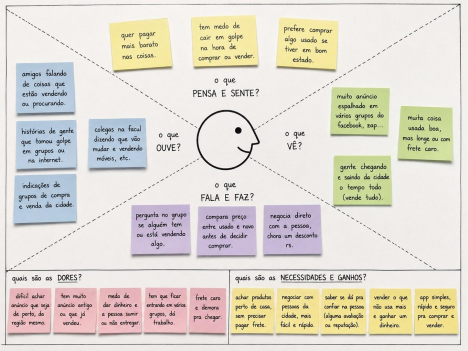

_Figura 1 – Mapa de empatia do DesapegaUai (Sprint 2)._

Também foram produzidos protótipos de baixa fidelidade para representar visualmente a proposta das telas. O primeiro (Figura 2) apresenta a tela de login, com campos de e-mail e senha, opção de recuperação de senha, aceite dos termos e alternativas de acesso por Google e Apple. O segundo (Figura 3) representa um esboço da organização da tela principal e de seus componentes.

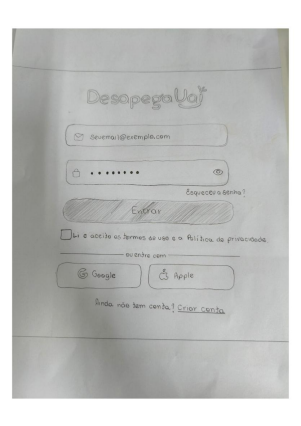

_Figura 2 – Protótipo de baixa fidelidade: tela de login (Sprint 2)._

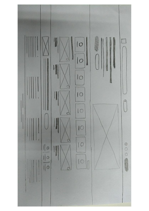

_Figura 3 – Protótipo de baixa fidelidade: tela principal (Sprint 2)._

Nesta Sprint também foram elaborados os Termos de Uso e a Política de Privacidade do projeto. O gráfico de Burndown (Figura 4) acompanha o trabalho restante ao longo da Sprint.

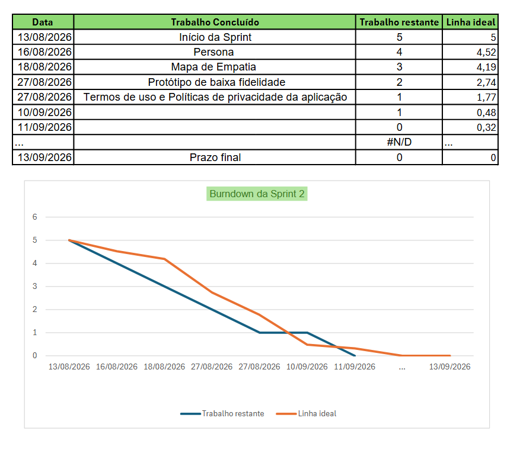

_Figura 4 – Gráfico de Burndown da Sprint 2._

### 4.3 Sprint 3 – Requisitos e casos de uso

A terceira Sprint avançou da compreensão dos usuários para a especificação do sistema. Foi produzido o documento de requisitos do MVP, organizado em requisitos funcionais e não funcionais. Entre as funcionalidades especificadas estão cadastro, login, logout, publicação, visualização, edição e exclusão de anúncios, alteração de status, gerenciamento dos próprios anúncios, página inicial, pesquisa, filtros e contato com o vendedor.

Os requisitos não funcionais abordam segurança, privacidade e conformidade com a LGPD, usabilidade e responsividade em computadores, tablets e smartphones. O documento também descreve critérios de aceitação, pré-condições, dados de entrada, regras de negócio, exceções e pós-condições.

O diagrama de casos de uso (Figura 5) representa graficamente as funcionalidades e as interações dos atores com o sistema. Ele complementa os casos de uso expandidos e a documentação de requisitos elaborada nesta etapa.

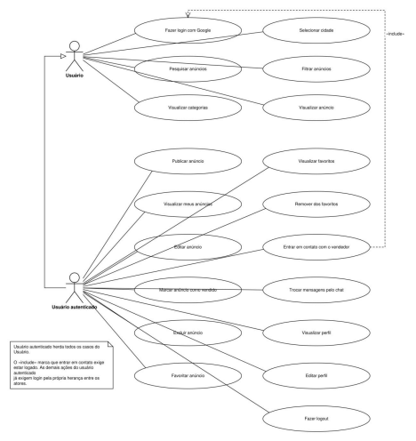

_Figura 5 – Diagrama UML de casos de uso (Sprint 3)._

O gráfico de Burndown da Sprint 3 (Figura 6) acompanha o trabalho restante até o prazo final.

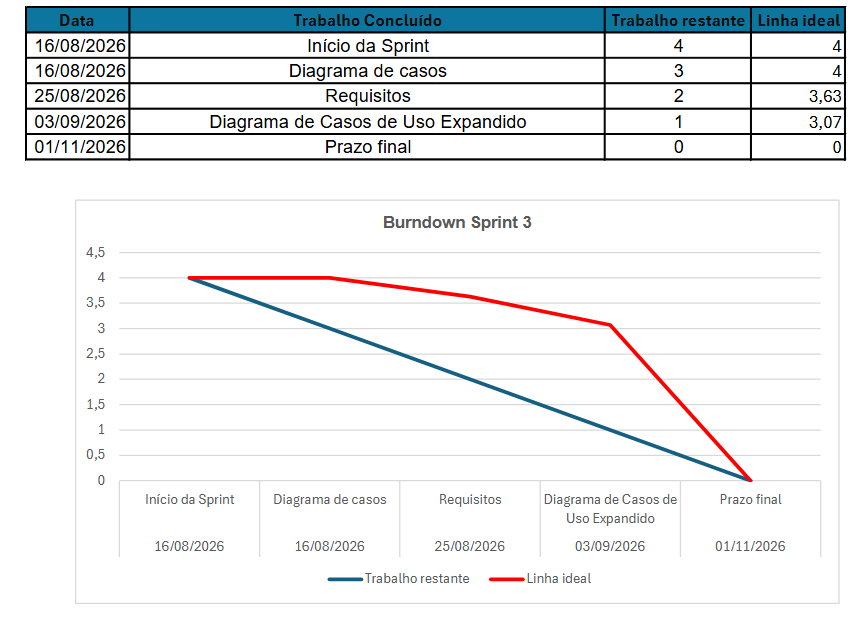

_Figura 6 – Gráfico de Burndown da Sprint 3._

**Definições consolidadas na implementação.** Os materiais de requisitos e os fluxos de casos de uso traziam diferenças em dois pontos, que foram fechados na Sprint 5: o método de autenticação ficou definido como login somente com a conta Google, e o limite de imagens ficou em até 8 fotos por anúncio.

### 4.4 Sprint 4 – Fluxos e estados

Na quarta Sprint, o grupo documentou os fluxos de atividades, os estados do sistema e o acompanhamento do trabalho por meio do Burndown. O diagrama de atividades representa a sequência de ações e decisões em quatro processos: fazer login com Google, publicar anúncio, pesquisar anúncios e entrar em contato com o vendedor.

O primeiro fluxo (Figura 7) representa o acesso público por autenticação Google, incluindo os caminhos de sucesso, de cancelamento ou falha e a identificação do primeiro acesso.

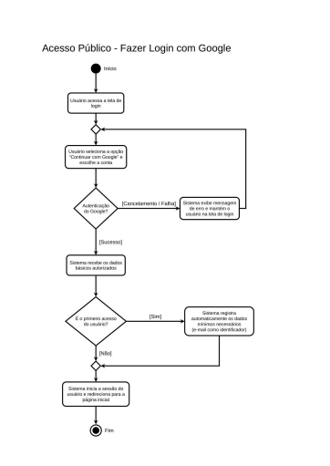

_Figura 7 – Diagrama de atividades: login com Google (Sprint 4)._

O segundo fluxo (Figura 8) detalha a publicação de um anúncio, incluindo a autenticação quando necessária, o preenchimento dos dados do produto, a validação e o retorno de erro ou sucesso.

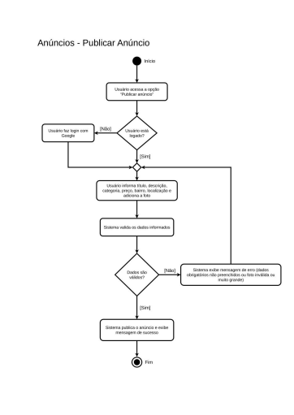

_Figura 8 – Diagrama de atividades: publicar anúncio (Sprint 4)._

O terceiro fluxo (Figura 9) apresenta a pesquisa por palavra-chave e filtros, com tratamento para a situação em que nenhum anúncio correspondente é encontrado.

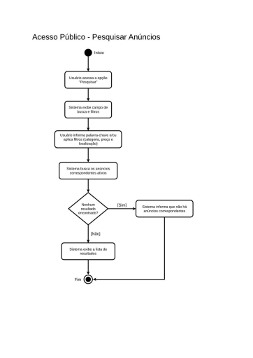

_Figura 9 – Diagrama de atividades: pesquisar anúncios (Sprint 4)._

O quarto fluxo (Figura 10) descreve o contato com o vendedor, desde a visualização do anúncio até o envio da mensagem e a confirmação ou nova tentativa em caso de erro.

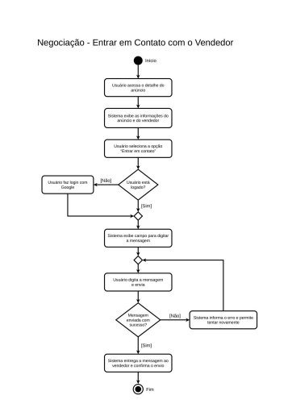

_Figura 10 – Diagrama de atividades: entrar em contato com o vendedor (Sprint 4)._

O diagrama de estados (Figura 11) representa os estados principais da plataforma, incluindo tela de boas-vindas, usuário autenticado ou não autenticado, navegação e pesquisa, visualização de anúncio, negociação, acordo fechado, publicação, anúncio ativo, pausado, excluído ou concluído, perfil do usuário e sessão encerrada. As transições indicam as ações que levam de um estado a outro.

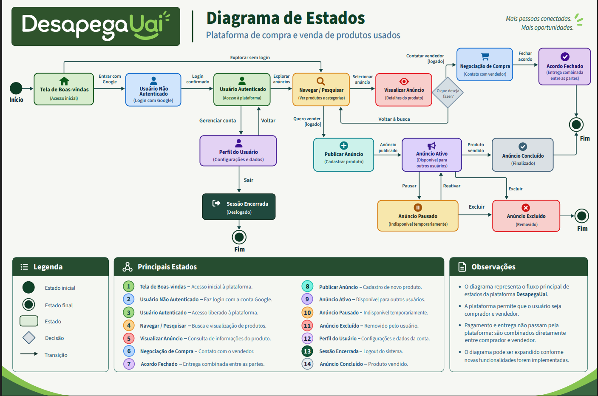

_Figura 11 – Diagrama de estados da plataforma DesapegaUai (Sprint 4)._

O gráfico de Burndown da Sprint 4 (Figura 12) registra as duas entregas da Sprint, o diagrama de atividades e o diagrama de estados.

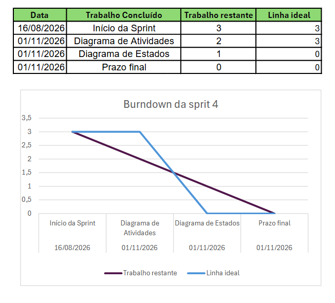

_Figura 12 – Gráfico de Burndown da Sprint 4._

### 4.5 Sprint 5 – Implementação, testes e entrega

Na Sprint 5, o grupo implementou o sistema, integrou o front-end à API e ao banco de dados, testou e preparou a entrega. O código está no repositório do projeto no GitHub, e o histórico registra as entregas:

| Data | Entrega |
| --- | --- |
| 04/11/2026 | Estrutura inicial do projeto |
| 07 e 08/11/2026 | Base da API e banco de dados; login com Google, perfil, categorias e cidades; anúncios e favoritos |
| 09/11/2026 | Busca de anúncios |
| 16 a 19/11/2026 | Telas de login, Home, categorias, favoritos, conversas e perfil; ligação entre as telas e avaliação do vendedor |
| 20/11/2026 | Conversas, mensagens e chat em tempo real |
| 21/11/2026 | Versão final: localização e mapa, notificações, fotos e denúncia no chat, perfil público do vendedor, Procura-se, tag de transporte, status reservado, selo de vínculo acadêmico, compromisso nas entregas, ajustes de visual, testes e relatório |

**Arquitetura.** O sistema tem três partes: o front-end (site em React), a API (Node.js com Express) e o banco de dados MySQL. O site conversa com a API por pedidos HTTP e por uma conexão em tempo real (Socket.IO), usada no chat, nos avisos e na atualização dos anúncios. A API está documentada em `/api/docs`.

**Banco de dados.** O modelo está em `backend/database/schema.sql`, com 20 tabelas: cidade, bairro, rua, usuario, categoria, subcategoria, anuncio, foto_anuncio, localizacao_anuncio, localizacao_usuario, preferencia_localizacao, favorito, conversa, mensagem, avaliacao, comparecimento, procura, denuncia, notificacao e inscricao_push. A base de locais reúne 142 cidades da Zona da Mata mineira, com seus bairros, localidades e ruas, a partir de dados públicos do IBGE e do OpenStreetMap.

**Diferença em relação à modelagem.** O diagrama de estados prevê a pausa de anúncio. Na versão entregue, o anúncio pode ser um rascunho, estar ativo, ser marcado como reservado (continua na busca, com a etiqueta) ou como vendido (sai da busca); a pausa ficou para uma próxima versão.

**Telas do sistema.** As capturas abaixo foram feitas na versão final, com os usuários de exemplo do banco de testes (os anúncios de exemplo não têm foto cadastrada).

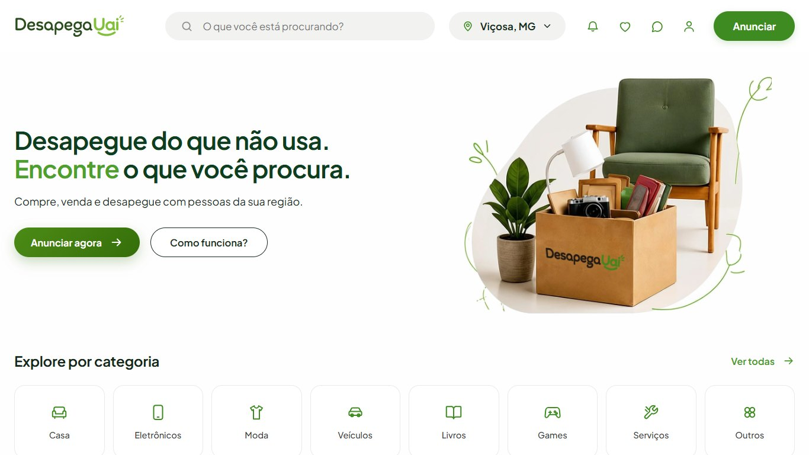

_Figura 13 – Tela inicial (Home)._

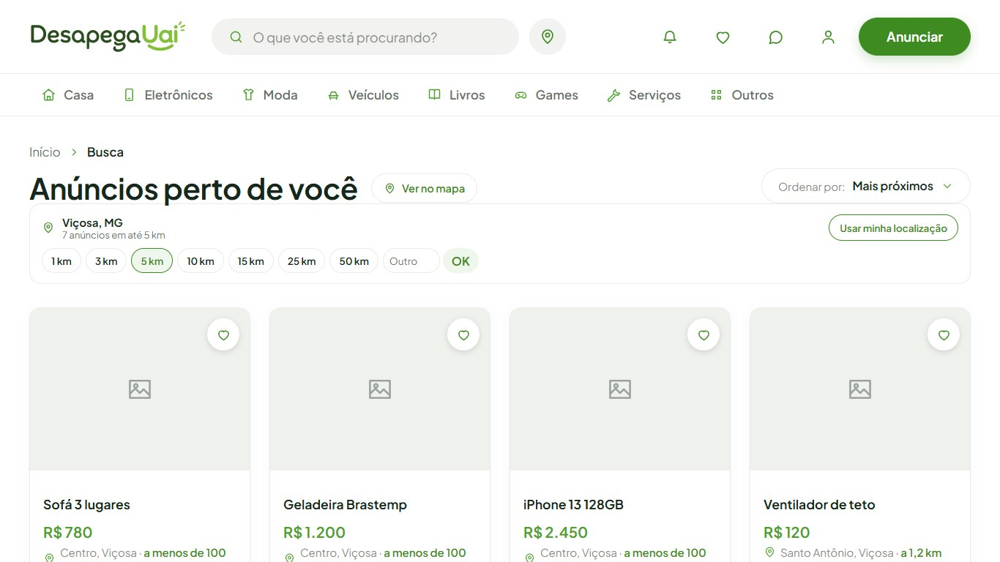

_Figura 14 – Busca de anúncios por proximidade, com a escolha da distância._

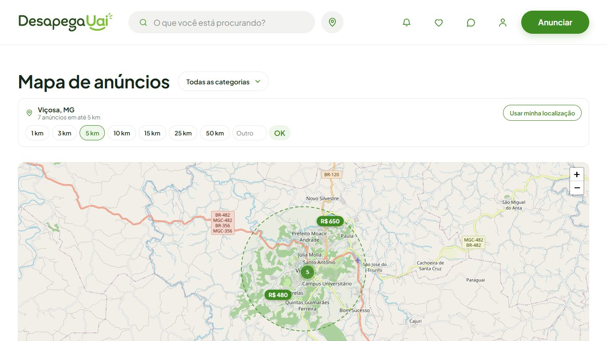

_Figura 15 – Mapa de anúncios, com os pontos aproximados._

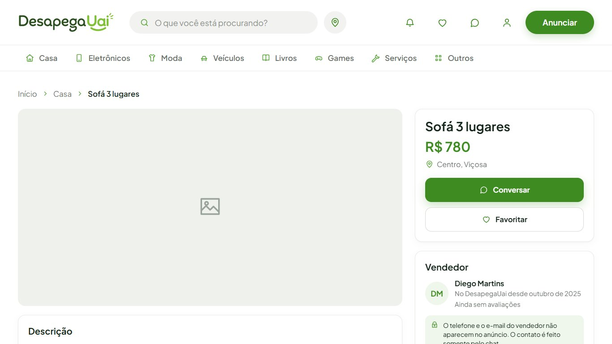

_Figura 16 – Página do anúncio._

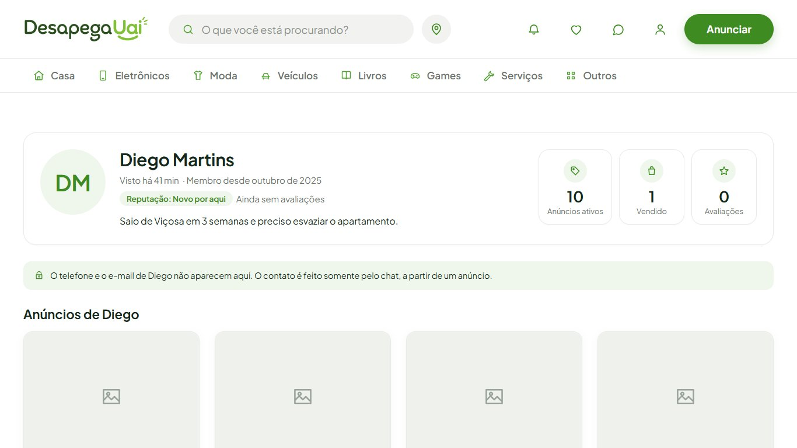

_Figura 17 – Perfil público do vendedor, com reputação, anúncios e avaliações._

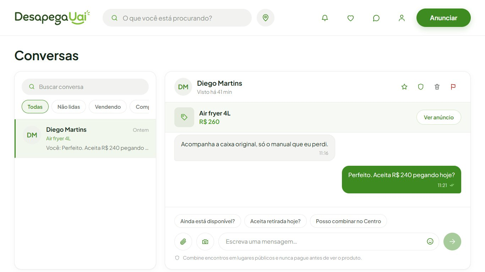

_Figura 18 – Chat em tempo real com o vendedor._

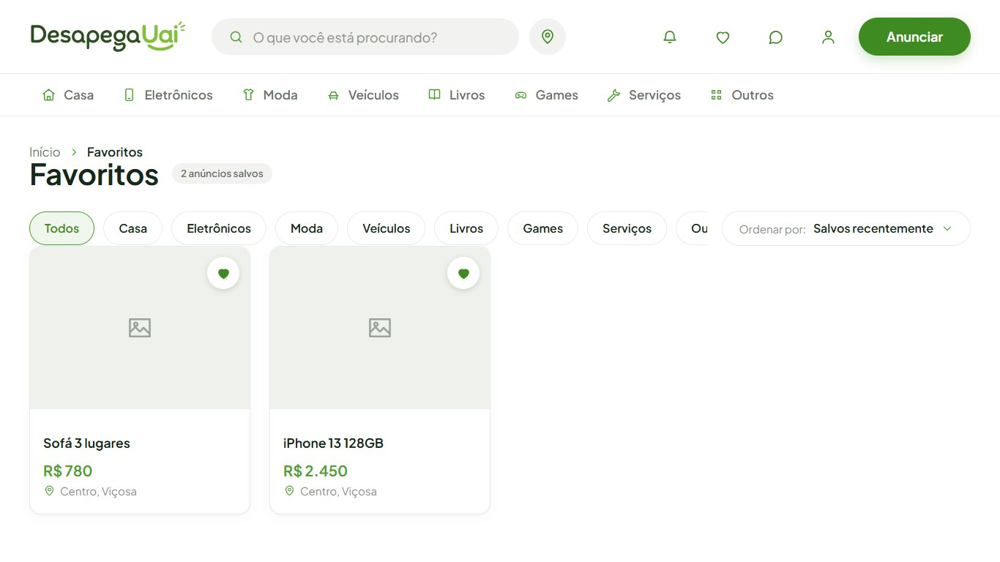

_Figura 19 – Favoritos._

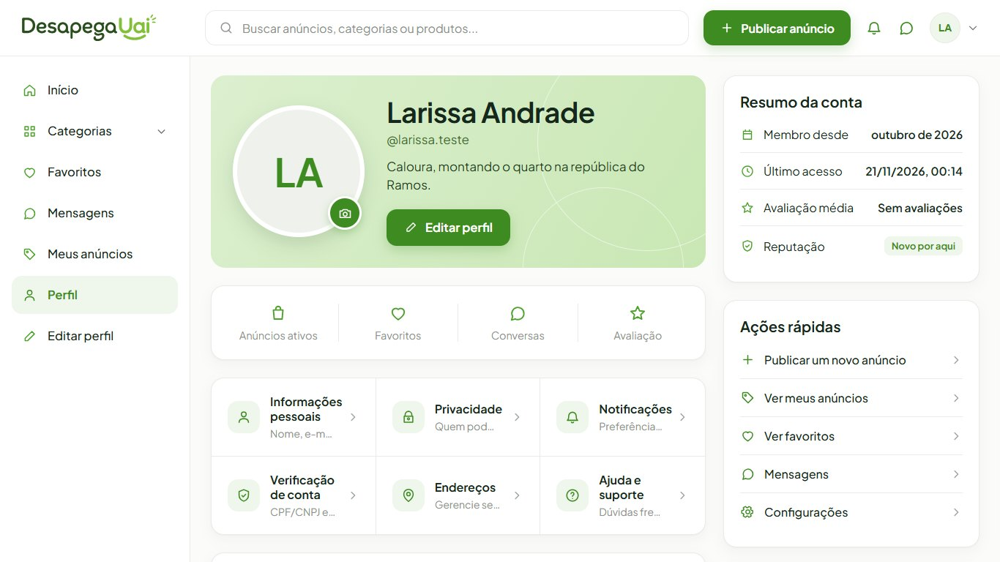

_Figura 20 – Perfil do usuário._

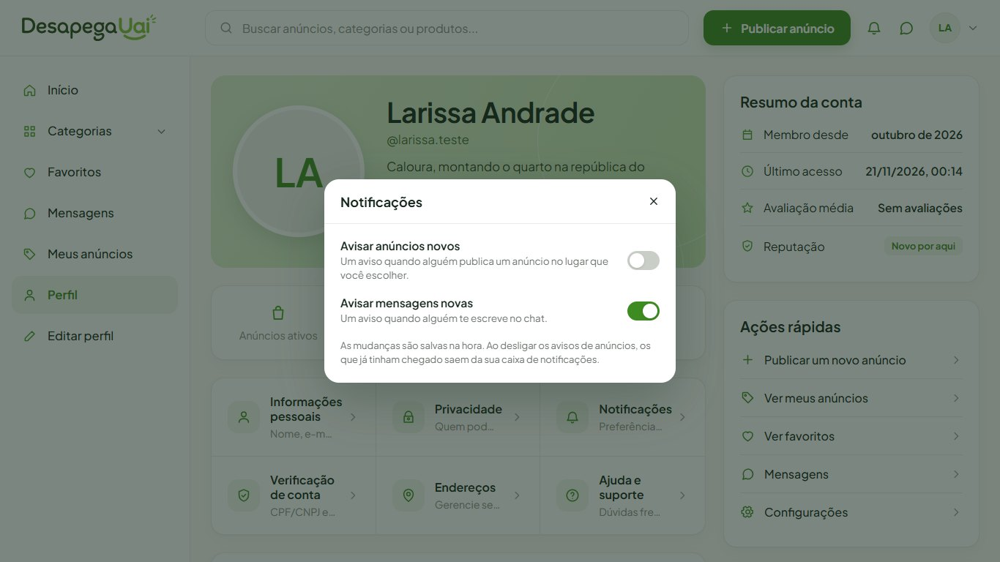

_Figura 21 – Preferências de notificações, com a escolha da localidade dos avisos._

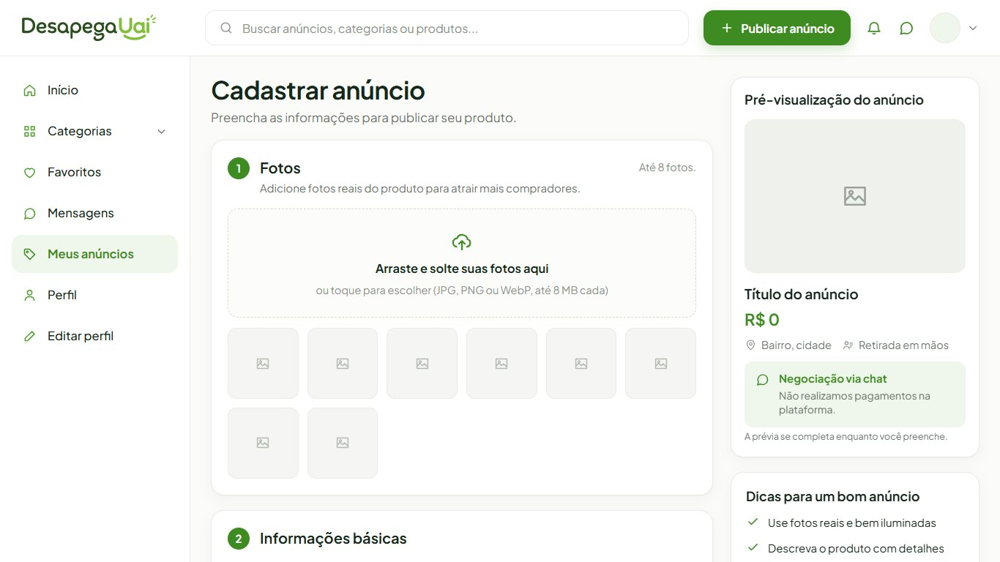

_Figura 22 – Publicação de anúncio._

| Home | Busca | Chat |
| --- | --- | --- |
|  | 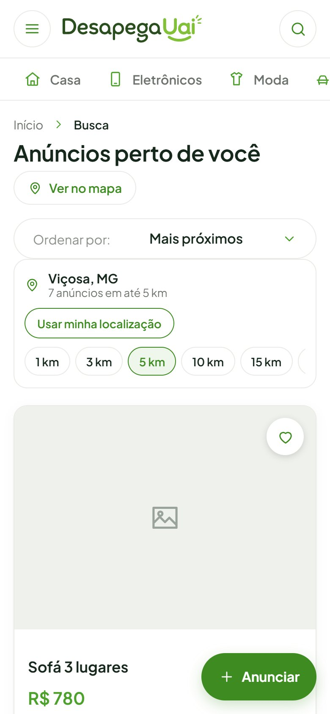 | 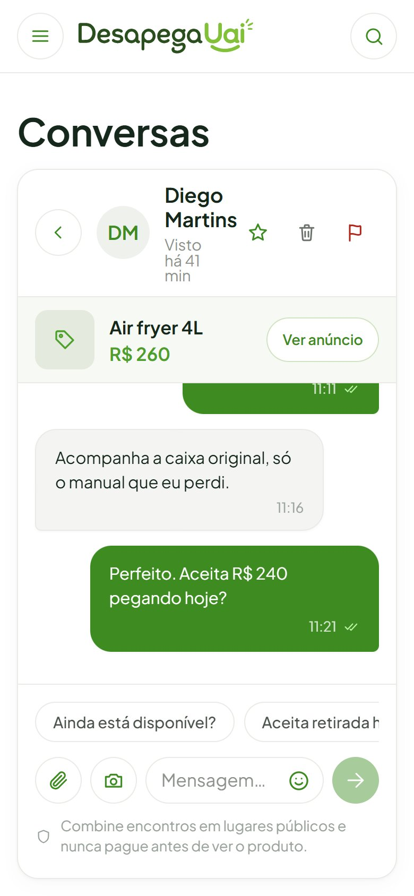 |

_Figura 23 – O sistema no celular: Home, busca e chat._

## 5. Testes

Resultados da versão final, conferidos em 21/11/2026.

| O que foi testado | Como | Resultado |
| --- | --- | --- |
| Funcionalidades da API (login, perfil, anúncios, favoritos, busca, localização, conversas, chat em tempo real, fotos do chat, avaliações, denúncias, notificações, Procura-se, tag de transporte, status reservado, selo de vínculo acadêmico, compromisso nas entregas, segurança e exclusão de imagens e de conta) | 232 testes automáticos, em 21 arquivos (`npm test` na pasta `backend`) | 232 de 232 aprovados |
| Fluxos no navegador (buscar por proximidade, trocar a distância, usar sem GPS, publicar anúncio, chat entre duas contas, avisos, perda de conexão, Procura-se e anúncio reservado) | 16 testes automáticos com Playwright, no Chrome (`npm run e2e` na pasta `frontend`) | 16 de 16 aprovados |
| Outros navegadores | Os mesmos 16 testes no Edge, no Firefox, no WebKit (motor do Safari), em tela de tablet e em tela de celular (Android e iPhone) | 16 de 16 no Edge, no Firefox, no WebKit e no tablet. No celular, 13 de 16: os outros 3 usam botões do cabeçalho de computador, e esses caminhos foram conferidos à parte |
| Segurança (autenticação, autorização e IDOR, XSS, CSRF e CORS, validação, upload e exclusão de imagens, privacidade, geolocalização, cabeçalhos HTTP, limite de requisições e carga) | Auditoria com 103 cenários, cada um com objetivo, requisição, resultado esperado, resultado obtido e evidência (`docs/seguranca/auditoria-de-seguranca.md`) | 103 de 103 aprovados |
| SQL injection | 1.441 pedidos de ataque em 42 parâmetros de consulta e 18 rotas de gravação | Nenhuma injeção funcionou |
| Tempo de resposta | 24 rotas da API, 29 telas e 13 ações medidas (chat em tempo real, publicação com fotos, favoritos, exclusão de conta) | Rotas em até 23 ms, telas prontas em até 1,2 s e mensagem do chat na tela da outra pessoa em 143 ms |
| Requisições da API durante o desenvolvimento | Testes manuais com Postman e Insomnia | Rotas conferidas pela equipe |
| Responsividade | 17 telas abertas em 360, 768 e 1280 px de largura, conferindo erros, imagens quebradas e rolagem lateral | Nenhum problema encontrado |
| Qualidade do código do front-end | Verificação automática (`npm run lint`) e geração da versão final (`npm run build`) | Sem erros |

Os testes automáticos no navegador foram executados no Chrome, no Edge, no Firefox e no WebKit, que é o motor do Safari. Testes em aparelhos reais da Apple e com usuários da comunidade ficam como próximo passo.

## 6. Resultados alcançados

O grupo estruturou a proposta do DesapegaUai, formalizou sua equipe, identificou o problema, organizou o acompanhamento das tarefas e desenvolveu os artefatos de análise e modelagem: personas, mapa de empatia, protótipos de baixa fidelidade, Termos de Uso e Política de Privacidade, especificação de requisitos do MVP, casos de uso expandidos, diagrama de casos de uso, diagramas de atividades e de estados e gráficos de Burndown das Sprints 2, 3 e 4.

A partir dessa documentação, a Sprint 5 entregou uma versão operacional do sistema, com o código no GitHub e os testes automáticos aprovados. O que ficou pronto:

- Qualquer pessoa pesquisa, filtra e abre anúncios sem cadastro, e vê primeiro os que estão mais perto.
- Quem entra com a conta Google publica anúncios com fotos, favorita, conversa em tempo real com o vendedor, envia fotos pelo chat e recebe avisos.
- Depois da venda, o comprador avalia o vendedor, e a reputação aparece no perfil público dele, junto com os anúncios ativos.
- O usuário escolhe de onde quer receber avisos de anúncios novos e pode denunciar um comportamento indevido pelo chat.
- Quem não acha o que quer publica um pedido no Procura-se e é avisado quando aparece um anúncio compatível na cidade; quem anuncia fica sabendo que já tem gente procurando.
- Cada anúncio informa como o item pode ser levado, e o vendedor marca como reservado enquanto combina a entrega.
- Quem entra com o e-mail da UFV ou da Univiçosa ganha o selo de vínculo acadêmico, e o perfil mostra a taxa de compromisso nas entregas.
- O site se adapta ao computador, ao tablet e ao celular.

Em relação ao escopo inicial do MVP, a versão entregue foi ampliada com a localização por proximidade, o mapa, as notificações, a avaliação do vendedor, a denúncia de usuário, o perfil público do vendedor, o Procura-se, a tag de transporte, o status reservado, os pontos de encontro seguros, o selo de vínculo acadêmico e o compromisso nas entregas. O projeto também foi apresentado em sala (pitch), e o grupo produziu o vídeo de apresentação do sistema e o banner do projeto.

O sistema roda em ambiente local (XAMPP com MySQL). A publicação em um endereço na internet é o próximo passo.

## 7. Dificuldades encontradas

- **Problemas técnicos:** dificuldades na configuração do ambiente de desenvolvimento, na execução da API e na correção de erros no código.
- **Desafios relacionados ao banco de dados:** dificuldades na conexão com o banco de dados e na integração dos dados com a API.
- **Organização e divisão de tarefas:** necessidade de organizar as responsabilidades de cada integrante, acompanhar o andamento das atividades e cumprir os prazos estabelecidos para cada Sprint.

Os problemas foram solucionados por meio de pesquisas, testes, correções no código, reuniões e colaboração entre os integrantes, buscando melhorar o desenvolvimento e o funcionamento do sistema.

## 8. Contribuição de cada integrante

As contribuições de cada integrante foram fundamentais para o desenvolvimento do projeto. Cada membro participou de diferentes etapas, do planejamento à implementação das funcionalidades.

| Integrante | Contribuições |
| --- | --- |
| Alice Risso Campos Faria | Participou da elaboração dos relatórios das Sprints e do relatório geral; desenvolveu o vídeo de apresentação do sistema; contribuiu para o desenvolvimento do front-end (tela de login) e para o repositório Git. |
| Anthony Araújo Rocha | Elaborou o mapa de empatia e os casos de uso expandidos; participou das reuniões e do desenvolvimento do back-end, principalmente na busca de anúncios, nas conversas e no chat do sistema; contribuiu com o Git; elaborou os slides da apresentação (pitch) e apresentou o projeto em sala. |
| Henrique Lucrécio Brandão | Participou da elaboração dos gráficos de Burndown, do desenvolvimento do front-end (tela inicial) e da organização do repositório Git; criou e organizou o quadro de tarefas no Trello. |
| João Pedro Fonseca Elias | Elaborou o diagrama de estados do sistema e os Termos de Uso e a Política de Privacidade. |
| Marina Vieira de Abreu | Elaborou o termo de aceite e os requisitos do sistema; participou do desenvolvimento do back-end (anúncios e favoritos); contribuiu com o repositório Git; participou da elaboração dos relatórios das Sprints e do relatório geral; desenvolveu o banner do projeto. |
| Rayanne Fernandes Fideles | Participou da elaboração dos gráficos de Burndown; elaborou o diagrama de atividades; contribuiu para o desenvolvimento do front-end; desenvolveu o protótipo de baixa fidelidade. |
| Rhayane de Freitas Eloi | Contribuiu com a ideia principal do projeto; elaborou as personas e o diagrama de casos de uso; participou do desenvolvimento do front-end e do back-end; realizou a integração entre as duas partes; criou o banco de dados e o repositório Git; organizou o repositório; realizou os testes de implementação e a finalização da versão entregue. |

## 9. Tecnologias e ferramentas utilizadas

| Categoria | Tecnologias e ferramentas |
| --- | --- |
| Linguagem de programação | JavaScript |
| Front-end | React 19 e Vite, com React Router; Leaflet para o mapa |
| Back-end | Node.js com Express 5 |
| Tempo real | Socket.IO (chat, avisos e atualização dos anúncios) |
| Banco de dados | MySQL, com gerenciamento pelo phpMyAdmin e ambiente local com XAMPP |
| Login | Google (Google Identity Services), com sessão em cookie protegido (JWT) |
| Imagens | Multer (envio) e Sharp (conversão para WebP em vários tamanhos) |
| Segurança | Helmet, limite de pedidos por tempo, CORS restrito ao endereço do site e conferência de origem nos pedidos que alteram dados |
| Documentação da API | Swagger (OpenAPI), em `/api/docs` |
| Testes | Postman e Insomnia (requisições da API); testes automáticos do Node.js (API) e Playwright (navegador) |
| Prototipação | Figma, para os protótipos e o planejamento visual do sistema |
| Gerenciamento | Trello, para as tarefas e o acompanhamento das Sprints; GitHub, para versionamento, armazenamento e compartilhamento do código |
| Comunicação | WhatsApp e e-mail |
| Documentação e apresentação | Google Docs, Microsoft Word, PowerPoint e Excel |
| Ambiente de desenvolvimento | Visual Studio Code (VS Code) |

## 10. Impacto e contribuição para a comunidade

O DesapegaUai busca facilitar a compra e a venda de produtos usados, oferecendo uma plataforma acessível e prática para conectar pessoas interessadas em vender e adquirir produtos. Como benefícios, espera-se proporcionar economia aos usuários, incentivar o reaproveitamento de produtos e facilitar o acesso a itens com preços mais acessíveis. O projeto contribui socialmente ao incentivar o consumo consciente e economicamente ao possibilitar uma renda extra para os vendedores, promovendo também a redução do desperdício e o aumento da vida útil dos produtos.

Além disso, o DesapegaUai busca promover uma maior interação entre a comunidade, incentivando a negociação de produtos entre pessoas e valorizando o comércio local. Por meio da tecnologia, o sistema torna essas negociações mais simples, organizadas e acessíveis, contribuindo para uma alternativa de consumo mais sustentável e para o aproveitamento de produtos que ainda têm utilidade, mas que muitas vezes ficam sem uso.

## 11. Considerações finais e próximos passos

O desenvolvimento do DesapegaUai permitiu ao grupo aplicar as etapas fundamentais da Engenharia de Software: da identificação de um problema e da compreensão dos usuários à especificação de requisitos, à modelagem do comportamento do sistema, à implementação e aos testes. A organização em Sprints e o uso do Trello contribuíram para estruturar o trabalho coletivo e acompanhar as entregas.

A proposta tem foco local e facilita a reutilização e a negociação de produtos usados em Viçosa e região. A versão entregue cobre todo o caminho de uma negociação: encontrar o produto perto de casa, conversar com o vendedor, combinar a venda e avaliar a experiência.

Próximos passos:

- **Publicar a plataforma** em um endereço com HTTPS. Isso é necessário para o login com Google, a câmera e a localização por GPS funcionarem no celular fora do ambiente de desenvolvimento.
- **Tela de administração** para a equipe analisar as denúncias registradas.
- **Avisos de mensagem nova com o site fechado** (notificação no aparelho), que hoje existem para anúncios novos e avaliações.
- **Pausa de anúncio**, prevista no diagrama de estados.
- **Bazar de Mudança:** um anúncio-vitrine com vários itens da mesma casa, data limite e baixa item por item, pensado para o fim de semestre.
- **Testes em aparelhos reais da Apple** e com usuários da comunidade.

## 12. Referências e materiais do projeto

Materiais produzidos pelo grupo:

- Termo de Aceite e Compromisso de Formação de Grupo – ByteForce.
- Relatórios das Sprints 1, 2, 3 e 4.
- Documento de Requisitos do MVP v1.0 – DesapegaUai.
- Documentação de casos de uso, Termos de Uso e Política de Privacidade.
- Quadro de acompanhamento do projeto no Trello: <https://trello.com/b/duOSoj3f/ads-300-2026-02-desapegauai>.
- Mapa de empatia, protótipos de baixa fidelidade, diagramas e gráficos de Burndown.
- Auditoria de segurança e testes da versão final (`docs/seguranca/auditoria-de-seguranca.md`).
- Repositório do projeto no GitHub: <https://github.com/DesapegaUai/DesapegaUai>.

Referências:

- BRASIL. Lei nº 13.709, de 14 de agosto de 2018. Lei Geral de Proteção de Dados Pessoais (LGPD).
- IBGE. Censo Demográfico 2022 e Cadastro Nacional de Endereços para Fins Estatísticos (CNEFE). Disponível em: <https://www.ibge.gov.br>.
- OPENSTREETMAP. Dados de mapas e de ruas. Disponível em: <https://www.openstreetmap.org>.
- Documentação do React. Disponível em: <https://react.dev>.
- Documentação do Express. Disponível em: <https://expressjs.com>.
- Documentação do Socket.IO. Disponível em: <https://socket.io>.
- Documentação do Leaflet. Disponível em: <https://leafletjs.com>.
- GOOGLE. Google Identity Services. Disponível em: <https://developers.google.com/identity>.
